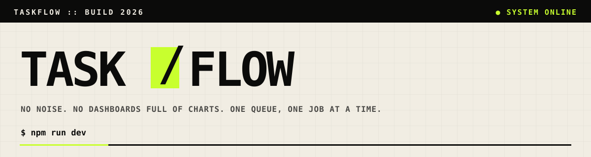
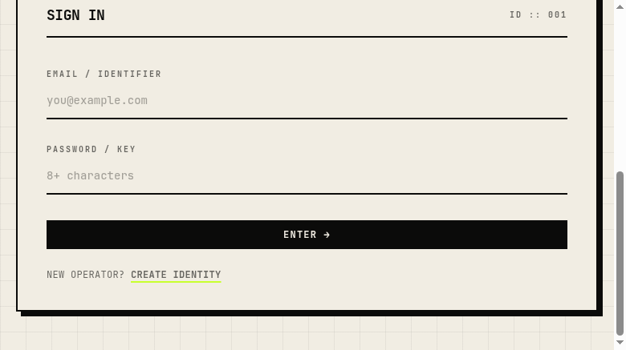
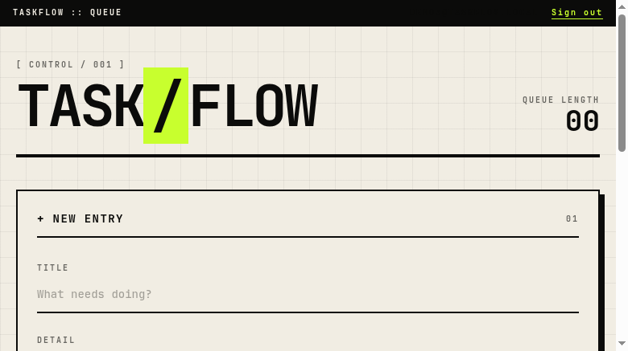
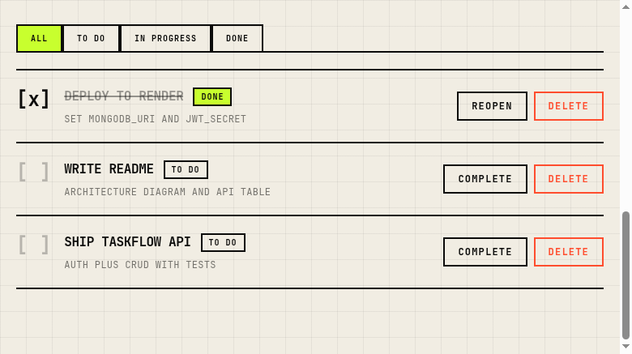
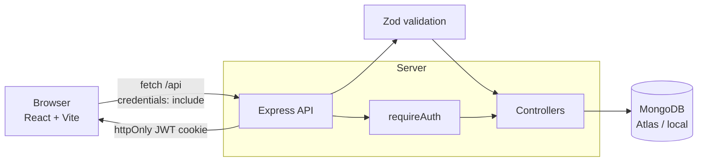

<div align="center">



<p><b>A MERN + TypeScript task manager built like a production system, styled like a terminal.</b></p>

<p>
  <a href="https://taskflow-lac5.onrender.com"></a>
  <a href="https://github.com/mannish01/TaskFlow/actions/workflows/ci.yml"></a>
  
  
  <a href="https://github.com/mannish01/TaskFlow/stargazers"></a>
</p>

<p>
  
  
  
  
  
</p>

<p><b>Live:</b> <a href="https://taskflow-lac5.onrender.com">https://taskflow-lac5.onrender.com</a></p>

<p><a href="#-screenshots">Screenshots</a> • <a href="#-architecture">Architecture</a> • <a href="#-api-reference">API</a> • <a href="#-quick-start">Quick start</a> • <a href="#-engineering-journal">Engineering journal</a></p>

</div>

---

## ⚡ What this is

Most portfolio to-do apps stop at local state. **TaskFlow** goes all the way through the request path that real products depend on:

> React form → REST API → Zod validation → MongoDB → httpOnly JWT cookie → protected routes → ownership checks → tests → CI → deployment config.

It is deliberately narrow. No AI, payments, WebSockets, second database, or fake complexity. The depth is in the details: stable error envelopes, per-user data isolation, cookie-based sessions, pagination, filters, and tests that prove the security boundary.

### Design direction

The UI is an opinionated **brutalist terminal**: warm paper, hard black rules, monospace type, offset shadows, and one acid-lime accent. No gradients, rounded SaaS cards, or default purple styling.

| Token | Value | Used for |
| --- | --- | --- |
| Paper | `#F1EDE3` | Page background, graph-paper grid |
| Ink | `#0B0B0A` | Text, borders, buttons |
| Acid | `#C8FF2E` | Active tab, done tag, links, wordmark slash |
| Rust | `#FF4D2E` | Destructive actions, errors |

---

## 📸 Screenshots

Real captures from a local run — not mockups.

<table>
  <tr>
    <td align="center" width="50%">
      <b>01 / ACCESS</b><br />
      
    </td>
    <td align="center" width="50%">
      <b>02 / EMPTY QUEUE</b><br />
      
    </td>
  </tr>
  <tr>
    <td align="center" colspan="2">
      <b>03 / LIVE QUEUE — one done, two to do</b><br />
      
    </td>
  </tr>
</table>

---

## 🧠 Architecture



### Request lifecycle

1. Browser sends a request with the session cookie.
2. `requireAuth` verifies the JWT and attaches `req.user`.
3. Zod validates the request body or query at the boundary.
4. The controller queries MongoDB with `user: req.user.id` baked into every task filter.
5. Responses use a single shape: `{ success: true, data }` or `{ success: false, error }`.

### Data model

| Collection | Fields | Notes |
| --- | --- | --- |
| `users` | `name`, `email`, `password`, timestamps | `email` unique + lowercase; `password` bcrypt hashed with `select: false` |
| `tasks` | `user`, `title`, `description`, `status`, `dueDate`, timestamps | `user` indexed; compound index `{ user: 1, status: 1, dueDate: 1 }` |

### Auth flow

<details>
<summary><b>Expand: how the session works</b></summary>

1. `POST /api/auth/register` or `/login` hashes/verifies the password with bcrypt and signs a JWT containing only `{ sub: userId }`.
2. The token is set as an **httpOnly, SameSite=Lax, Secure-in-production** cookie. It is never written to `localStorage`.
3. `requireAuth` verifies the cookie on every protected route.
4. `GET /api/auth/me` loads the user from MongoDB and returns the public shape: `id`, `name`, `email`.

</details>

---

## 🔌 API reference

All errors use:

```json
{ "success": false, "error": { "code": "VALIDATION_ERROR", "message": "...", "details": [] } }
```

All successes use:

```json
{ "success": true, "data": { } }
```

<details>
<summary><b>Expand: all 10 endpoints</b></summary>

| Method | Path | Auth | Purpose |
| --- | --- | --- | --- |
| `GET` | `/api/health` | — | Liveness check |
| `POST` | `/api/auth/register` | — | Create account, set cookie |
| `POST` | `/api/auth/login` | — | Verify password, set cookie |
| `POST` | `/api/auth/logout` | — | Clear cookie |
| `GET` | `/api/auth/me` | ✅ | Current public user |
| `POST` | `/api/tasks` | ✅ | Create a task |
| `GET` | `/api/tasks?status=&dueBefore=&dueAfter=&page=&limit=` | ✅ | List own tasks, filtered + paginated |
| `GET` | `/api/tasks/:id` | ✅ | Get one own task |
| `PATCH` | `/api/tasks/:id` | ✅ | Update own task (partial) |
| `DELETE` | `/api/tasks/:id` | ✅ | Delete own task |

</details>

**Example create body**

```json
{
  "title": "Ship TaskFlow",
  "description": "Finish the CRUD slice",
  "status": "in_progress",
  "dueDate": "2026-12-01T10:00:00.000Z"
}
```

`status` accepts `todo`, `in_progress`, `done`. `dueDate` may be an ISO string, `null`, or omitted.

---

## 📁 Project structure

```text
TaskFlow/
├── client/                 React + Vite + Tailwind
│   ├── src/
│   │   ├── components/     ProtectedRoute, TaskItem + tests
│   │   ├── context/        AuthContext
│   │   ├── pages/          Login, Register, Tasks
│   │   └── lib/            api.ts (credentials: include)
│   └── tailwind.config.js  paper / ink / acid / rust tokens
├── server/                 Express + TypeScript
│   ├── src/
│   │   ├── controllers/    auth, tasks
│   │   ├── middleware/     requireAuth, errorHandler
│   │   ├── models/         User, Task
│   │   ├── routes/         authRoutes, taskRoutes
│   │   └── validators/     Zod schemas
│   └── tests/              supertest + mongodb-memory-server
├── docs/
│   ├── assets/hero.svg
│   └── screenshots/
├── .github/workflows/ci.yml
├── Dockerfile
├── docker-compose.yml
├── render.yaml
└── package.json            root scripts for install/dev/build/test
```

---

## 🚀 Quick start

Requirements: **Node 20+** (tested on Node 26), npm, and MongoDB locally or Atlas.

```bash
git clone https://github.com/mannish01/TaskFlow.git
cd TaskFlow
npm run install:all
cp .env.example .env
# set JWT_SECRET to a long random string
# set MONGODB_URI to your database
npm run dev
```

| Service | URL |
| --- | --- |
| Client (Vite) | http://localhost:5173 |
| API health | http://localhost:5000/api/health |

<details>
<summary><b>Alternative: Docker</b></summary>

```bash
docker compose up --build
```

The API then serves the built client on **http://localhost:5000**.

</details>

### Environment variables

| Variable | Required | Example | Notes |
| --- | --- | --- | --- |
| `PORT` | No | `5000` | API port |
| `NODE_ENV` | No | `development` | `production` enables Secure cookies |
| `MONGODB_URI` | ✅ | `mongodb://127.0.0.1:27017/taskflow` | Local or Atlas connection string |
| `JWT_SECRET` | ✅ | long random string | Signing key; never commit it |
| `JWT_EXPIRES_IN` | No | `7d` | Token lifetime |
| `COOKIE_SECURE` | No | `false` | Set `true` behind HTTPS |
| `CLIENT_ORIGIN` | No | `http://localhost:5000` | CORS allowlist |

---

## ✅ Verification

```bash
npm test          # 8 API tests + 2 UI tests = 10 passing
npm run build     # TypeScript + Vite production build
```

- API tests use `mongodb-memory-server` — no external database required.
- One test registers two users and proves the second cannot read, update, or delete the first user's task.
- The UI test covers complete/reopen and delete actions.

---

## 🌐 Deployment

| Target | File | What happens |
| --- | --- | --- |
| GitHub Actions | `.github/workflows/ci.yml` | Installs both packages, builds server, runs all tests, builds client |
| Docker | `Dockerfile` | Multi-stage build; API also serves `client/dist` |
| Docker Compose | `docker-compose.yml` | API + MongoDB with a persistent volume |
| Render | `render.yaml` | Web service blueprint; set `MONGODB_URI`, generate `JWT_SECRET` |

`render.yaml` is ready; it still needs your MongoDB connection string before you deploy.

---

## 🛠 Engineering journal

The interesting part of this build was the debugging, not the typing.

<details>
<summary><b>1. ts-jest could not compile import.meta</b></summary>

The env loader used `import.meta.url`, which Jest treated as CommonJS. Fixed by resolving `.env` from `process.cwd()` and its parent instead.

</details>

<details>
<summary><b>2. ESM TypeScript under Jest</b></summary>

Added `tsconfig.test.json` with `module: CommonJS` and pointed `ts-jest` at it.

</details>

<details>
<summary><b>3. mongodb-memory-server downloaded during the test run</b></summary>

The suite timed out and a partial binary could not be renamed. Fixed by prewarming the binary once and setting `testTimeout: 120000`.

</details>

<details>
<summary><b>4. /api/auth/me returned an empty email</b></summary>

The middleware only knows the JWT subject. Fixed by loading the user from MongoDB in the `me` controller and returning the public shape.

</details>

<details>
<summary><b>5. Cookie SameSite blocked localhost cross-origin auth</b></summary>

Fixed with a Vite `/api` proxy so development and production are same-origin.

</details>

<details>
<summary><b>6. dueDate: null became 1970-01-01</b></summary>

Zod's `z.coerce.date()` happily coerces `null` to the Unix epoch. Caught in a real screenshot, fixed by validating an ISO string or `null` and transforming only non-null values, then added a regression test.

</details>

---

## 🎤 Interview notes

| Question | Answer |
| --- | --- |
| Why httpOnly cookies instead of localStorage? | Scripts cannot read them, so XSS cannot directly steal the session; SameSite=Lax reduces CSRF exposure. |
| How are tasks isolated? | Every task query includes `user: req.user.id`; no endpoint accepts a user id from the client. |
| What happens with invalid input? | Zod rejects it at the boundary and the error handler returns a stable `VALIDATION_ERROR` envelope with field details. |
| Why Zod on both sides? | Shared schema style keeps validation rules close to the data contract; server validation remains authoritative. |
| What would I add next? | Refresh-token rotation, request-id logging, and a `completedAt` field for analytics. |

---

## 🗺 Roadmap

- [x] Auth with bcrypt + httpOnly cookie
- [x] Task CRUD with ownership checks
- [x] Filters, pagination, stable error envelope
- [x] 10 passing tests + CI
- [x] Brutalist terminal redesign
- [x] Styled GitHub README with hero and badges
- [ ] Refresh-token rotation
- [ ] Request-id structured logging
- [ ] Live Render deployment

---

## 📄 License

[MIT](LICENSE) © 2026 Manish

---

<div align="center">

<b>Built by Manish</b> • <a href="https://github.com/mannish01">GitHub</a> • <a href="https://github.com/mannish01/TaskFlow">Repository</a>

<br /><br />

<code>while (tasks.length) { ship(); }</code>

</div>
