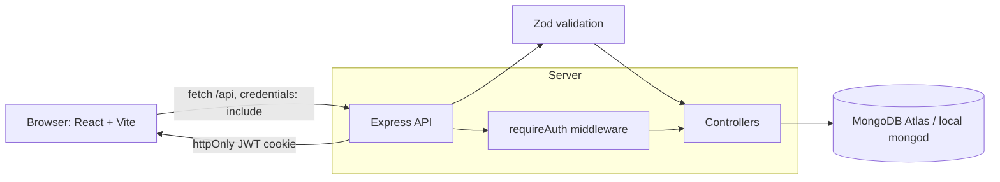

# TaskFlow

A focused MERN + TypeScript task manager built as the first real full-stack portfolio project. It proves the whole request path: React form → REST API → Zod validation → MongoDB → JWT httpOnly cookie → protected routes → tests → CI → deployment config.

## Why this project exists

Generic "to-do apps" are weak portfolio pieces. TaskFlow is deliberately narrow but production-shaped: per-user data isolation, httpOnly-cookie auth, one consistent error envelope, server-side validation, pagination, filters, tests for the ownership boundary, and a CI pipeline. No AI, payments, WebSockets or second database.

## Architecture



### Data model

- `User`: `name`, `email` (unique, lowercase), `password` (bcrypt hash, `select: false`)
- `Task`: `user` (required ObjectId ref, indexed), `title`, `description`, `status` (`todo | in_progress | done`), `dueDate`, timestamps
- Compound index: `{ user: 1, status: 1, dueDate: 1 }`

### Auth flow

1. `POST /api/auth/register` or `/login` hashes/verifies the password with bcrypt and signs a JWT containing only `{ sub: userId }`.
2. The token is set as an **httpOnly, SameSite=Lax, Secure-in-production** cookie. It is never placed in `localStorage`.
3. `requireAuth` verifies the cookie on every protected route and attaches `req.user`.
4. `/api/auth/me` loads the current user from MongoDB and returns the public shape (`id`, `name`, `email`).

## API

All errors use `{ success: false, error: { code, message, details? } }`. All successes use `{ success: true, data: ... }`.

| Method | Path | Auth | Purpose |
| --- | --- | --- | --- |
| GET | `/api/health` | No | Liveness check |
| POST | `/api/auth/register` | No | Create account, set cookie |
| POST | `/api/auth/login` | No | Verify password, set cookie |
| POST | `/api/auth/logout` | No | Clear cookie |
| GET | `/api/auth/me` | Yes | Current public user |
| POST | `/api/tasks` | Yes | Create a task |
| GET | `/api/tasks?status=&dueBefore=&dueAfter=&page=&limit=` | Yes | List own tasks with filters and pagination |
| GET | `/api/tasks/:id` | Yes | Get one own task |
| PATCH | `/api/tasks/:id` | Yes | Update own task (partial) |
| DELETE | `/api/tasks/:id` | Yes | Delete own task |

Example create body:

```json
{
  "title": "Ship TaskFlow",
  "description": "Finish the CRUD slice",
  "status": "in_progress",
  "dueDate": "2026-12-01T10:00:00.000Z"
}
```

`dueDate` may be `null` or omitted.

## Local setup

Requirements: Node 20+ (tested on Node 26), npm, and MongoDB either locally or Atlas.

```bash
git clone https://github.com/mannish01/TaskFlow.git
cd TaskFlow
npm run install:all
cp .env.example .env
# edit .env: set JWT_SECRET to a long random string and MONGODB_URI to your database
npm run dev
```

- Client: http://localhost:5173 (Vite proxies `/api` to port 5000)
- API: http://localhost:5000/api/health

With Docker instead:

```bash
docker compose up --build
```

The API then serves the built client on http://localhost:5000.

## Verification

```bash
npm test          # 7 API tests + 2 UI tests
npm run build     # TypeScript + Vite production build
```

The API tests use `mongodb-memory-server`, so no external database is needed. One test registers two users and proves the second cannot read, update or delete the first user's task.

## Deployment

- `Dockerfile` builds client and server and runs the API, which also serves `client/dist`.
- `render.yaml` is a Render blueprint; set `MONGODB_URI` and let Render generate `JWT_SECRET`.
- CI in `.github/workflows/ci.yml` installs both packages, builds the server, runs API and UI tests, then builds the client.

## Screenshots

| Screen | Image |
| --- | --- |
| Sign in | `docs/screenshots/01-login.png` |
| Empty dashboard | `docs/screenshots/02-tasks-empty.png` |
| Filled dashboard with filters and completed task | `docs/screenshots/03-tasks-filled.png` |

These are real screenshots from a local run, not mockups.

## What broke and how I fixed it

1. **`ts-jest` could not compile `import.meta`** in the env loader. Fixed by loading `.env` from `process.cwd()` and its parent instead of an `import.meta.url` path.
2. **Jest treated ESM TypeScript as CommonJS.** Added `tsconfig.test.json` with `module: CommonJS` and pointed `ts-jest` at it.
3. **`mongodb-memory-server` was downloading its binary during the test run**, so the suite timed out and the partial download could not be renamed. Fixed by prewarming the binary once and setting `testTimeout: 120000`.
4. **`/api/auth/me` returned an empty email** because the middleware only knows the JWT subject. Fixed by loading the user from MongoDB in the `me` controller and returning the public shape.
5. **Cookie SameSite and localhost cross-origin development** would block auth in some browsers. Fixed with a Vite `/api` proxy so dev and prod are same-origin.
6. **`dueDate: null` became 1970-01-01** because Zod's `z.coerce.date()` happily coerces `null` to the Unix epoch. Caught in a real screenshot, fixed by validating an ISO string or `null` and transforming only non-null values, then added a regression test.

## Interview notes

- Why httpOnly cookies instead of localStorage? Scripts cannot read them, so an XSS bug cannot directly steal the session; SameSite=Lax reduces CSRF exposure.
- How are tasks isolated? Every query includes `user: req.user.id`; there is no endpoint that takes a user id from the client.
- What happens with invalid input? Zod rejects it at the boundary and the error handler returns a stable `VALIDATION_ERROR` envelope with field details.
- What would I add next? Refresh-token rotation, request id logging, and a migration to add a `completedAt` field for analytics.
